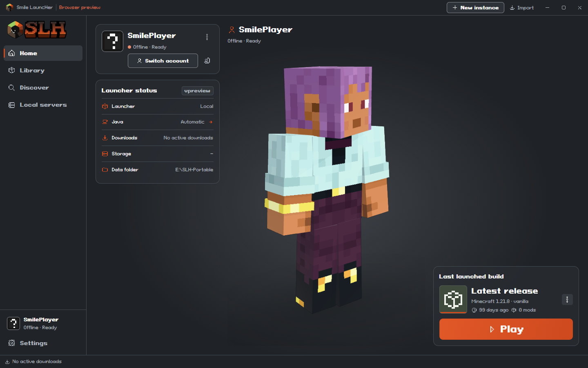
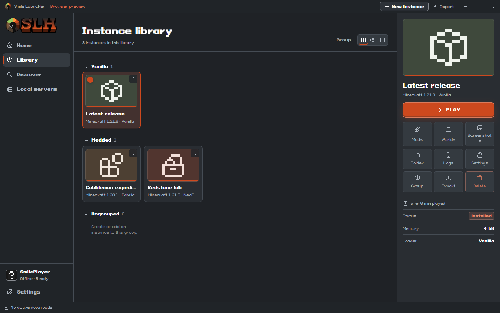
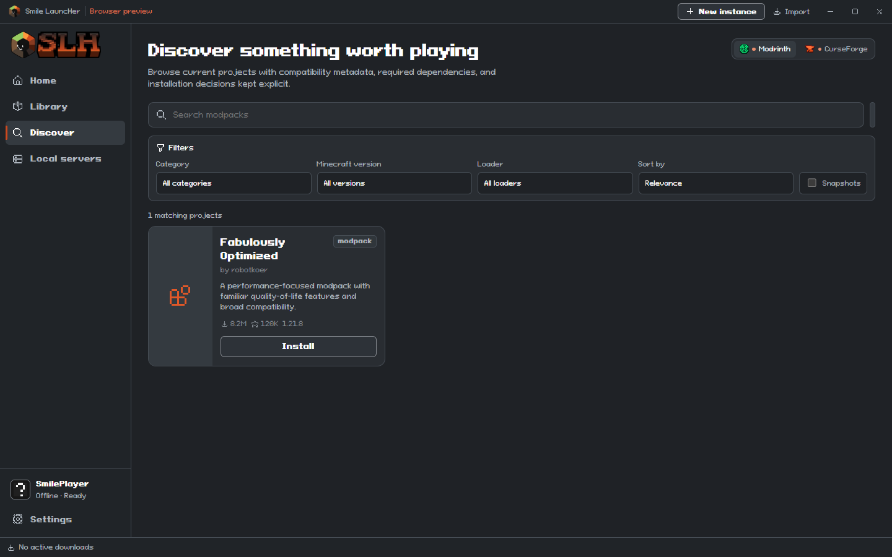
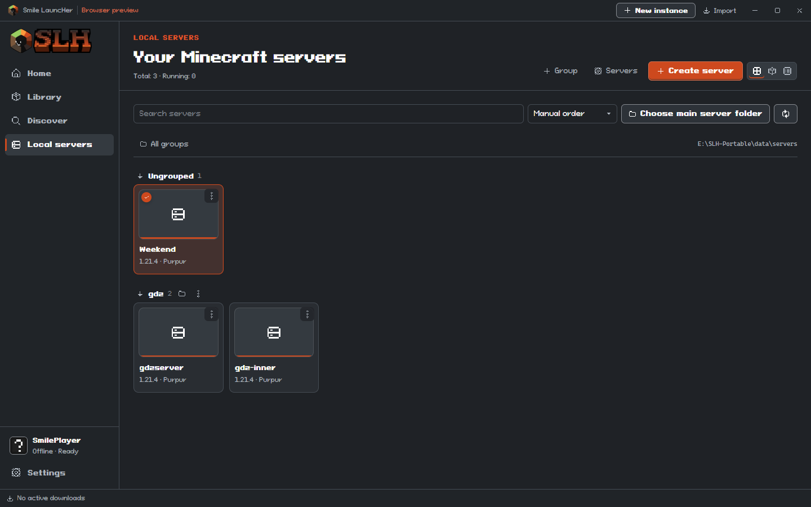
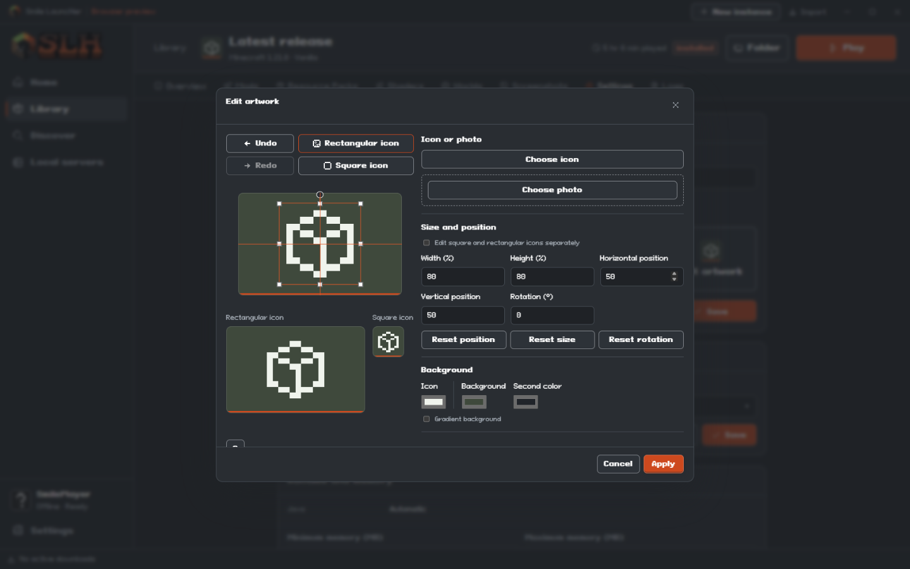
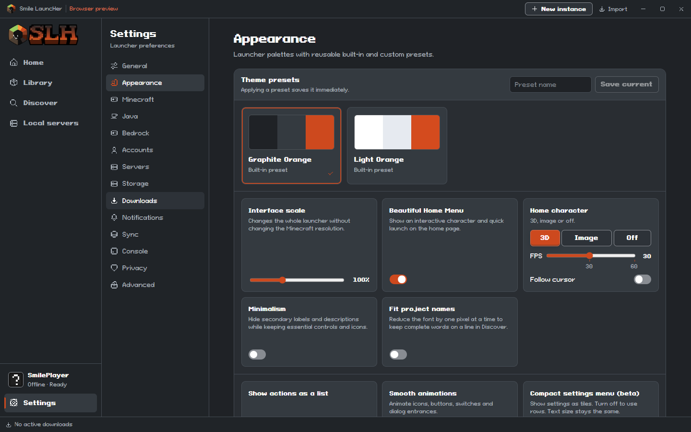
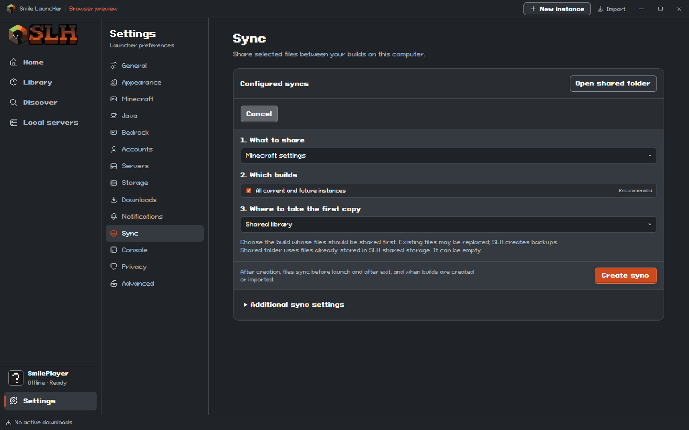

<p align="center"></p>

# Smile LauncHer

Ein Minecraft-Launcher für Windows, macOS und Linux mit getrennten Java-Instanzen, Inhaltskatalogen und Verwaltung lokaler Server.

[English](README.md) · [Русский](README.ru.md) · [Deutsch](README.de.md)

## Funktionen

- Java-Instanzen mit Vanilla, Fabric, Forge, NeoForge und Quilt, Gruppen, Raster-/Listenansicht und eigenen Einstellungen.
- Microsoft-, Ely.by- und Offline-Konten, verwaltete Java-Laufzeiten und Erkennung installierter Versionen.
- Modrinth- und CurseForge-Kataloge für Modpacks, Mods, Ressourcenpakete und Shader mit Versions- und Loaderfiltern.
- Lokale Server mit Konsole, Konfiguration, Zugriffslisten und Installation von Java-Serverkernen.
- Eigene Bilder für Instanzen und Server, Drehung, Einrasten sowie Rückgängig/Wiederholen.
- Java-Absturzdiagnose mit Logbelegen und Verweisen auf passende Einstellungen.
- Lokale Synchronisierung ausgewählter Dateien zwischen Instanzen.
- Themes, Panelpositionen, konfigurierbare Animationen und ein optionaler 3D-Charakter auf der Startseite.
- Deutsch, Englisch und Russisch sowie eigene Übersetzungsdateien.

Bedrock ist nur unter Windows verfügbar und verwendet gemeinsame offizielle Spieldaten. Installierte Store- und Preview-Pakete können eingebunden werden; Preview wird über Store/Xbox installiert. Eine Isolation des offiziellen Bedrock ist derzeit nicht verfügbar. Siehe [Bedrock-Unterstützung](docs/bedrock-support.md).

Die optionale Integration des Rust-Clients und -Servers Horizon ist experimentell und benötigt kompatible Veröffentlichungen und Hardware.

## Screenshots

In Chrome mit der Browser-Vorschau und Demonstrationsdaten aufgenommen. Kontonamen, Instanzen und Katalogergebnisse sind Beispiele.



<details>
<summary>Instanzbibliothek</summary>



</details>

<details>
<summary>Inhaltskataloge</summary>



</details>

<details>
<summary>Lokale Server</summary>



</details>

<details>
<summary>Bildeditor</summary>



</details>

<details>
<summary>Darstellung</summary>



</details>

<details>
<summary>Synchronisierung einrichten</summary>



</details>

## Download

Wähle auf [GitHub Releases](https://github.com/slhmc/slh/releases) ein Paket für dein Betriebssystem. Testversionen sind als Pre-release gekennzeichnet.

| Plattform | Installer / Paket | Portable / App-Archiv |
| --- | --- | --- |
| Windows x64 | EXE, MSI | Portable ZIP |
| macOS Intel | DMG | App ZIP |
| macOS Apple Silicon | DMG | App ZIP |
| Linux x64 | DEB, RPM | AppImage |

Entpacke das vollständige Windows-Portable-ZIP in einen beschreibbaren Ordner und starte SLH.exe. Daten liegen neben der Anwendung. Neue Installer-Installationen verwenden den Benutzerdatenordner; bestehende Daten älterer Installationen bleiben erhalten. macOS/Linux verwenden standardmäßig die jeweiligen Benutzerdatenverzeichnisse.

Windows benötigt Microsoft Edge WebView2 Evergreen. Fehlt die Laufzeit, folge dem Launcher-Link zum Microsoft-Installer und starte SLH erneut. macOS verwendet System-WebKit, Linux benötigt WebKitGTK. Minecraft, Java und Inhalte werden bei Bedarf heruntergeladen.

Windows-/Linux-Pakete sind unsigniert. macOS-Pakete sind ad hoc signiert und nicht notarisiert.

## Daten und Konten

Profile und Einstellungen werden lokal gespeichert. Anmeldung, Downloads und Updateprüfungen kontaktieren die jeweiligen Dienste. Microsoft-Anmeldung und CurseForge-Zugriff hängen bei eigenen Builds von der Konfiguration ab. Siehe [Authentifizierung](AUTH.md) und [CurseForge-Zugriff](CURSEFORGE_RELAY.md).

Der Datenordner kann Zugangsdaten, Welten und private Serverinformationen enthalten. Halte ihn privat und sichere wichtige Welten vor Versionswechseln und Tests von Vorabversionen.

## Bauen und mitwirken

Plattformvoraussetzungen und Paketerstellung stehen in [BUILDING.md](BUILDING.md), Entwicklungsanweisungen in [DEVELOPMENT.md](DEVELOPMENT.md). Unter Windows muss zusätzlich der dort beschriebene Bedrock-Helfer gebaut werden.

React und TypeScript bilden die Oberfläche. Tauri/Rust übernimmt Spielstart, Dateien und SQLite-Speicherung.

```sh
git clone --recurse-submodules https://github.com/slhmc/slh.git
cd slh
npm ci
npm run tauri:dev
```

## Dokumentation und Support

- [Architektur](ARCHITECTURE.md)
- [Sprachen](LANGUAGES.md)
- [Portabler Speicher](PORTABLE.md)
- [Fehler melden oder Funktion vorschlagen](https://github.com/slhmc/slh/issues)

## Lizenz

GPL v3. Siehe [LICENSE](LICENSE).
