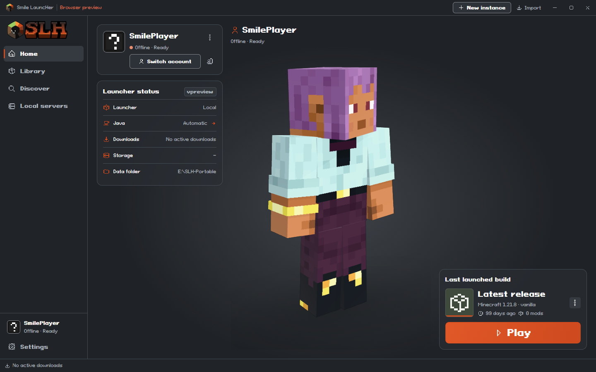
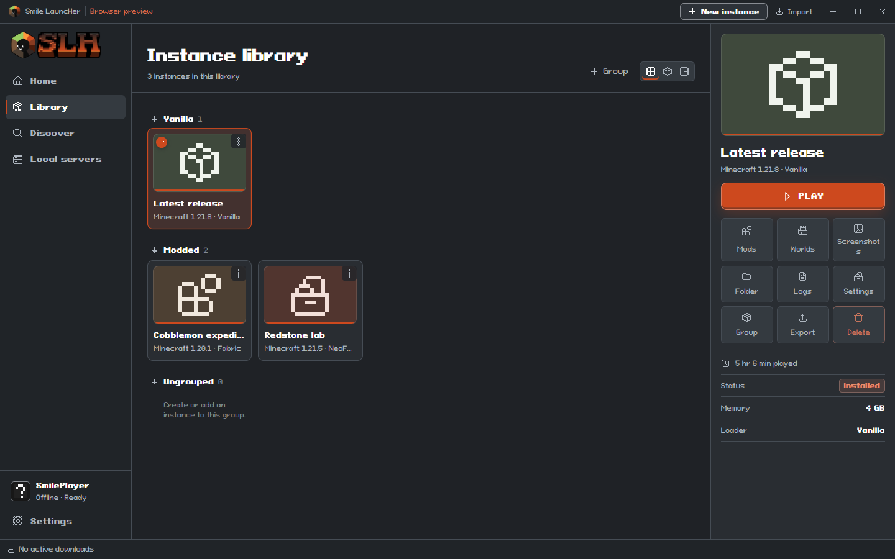
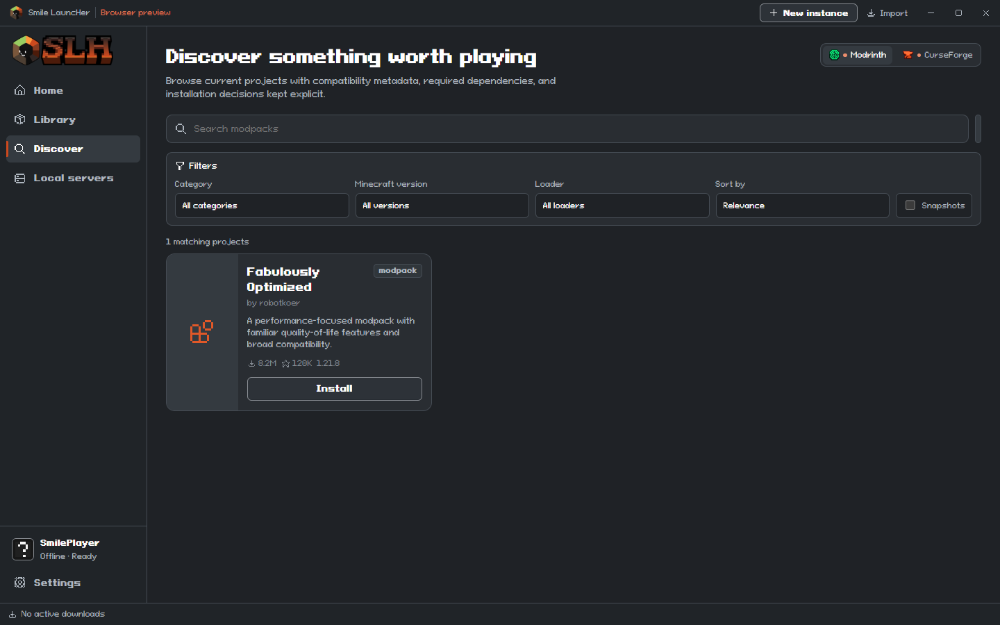
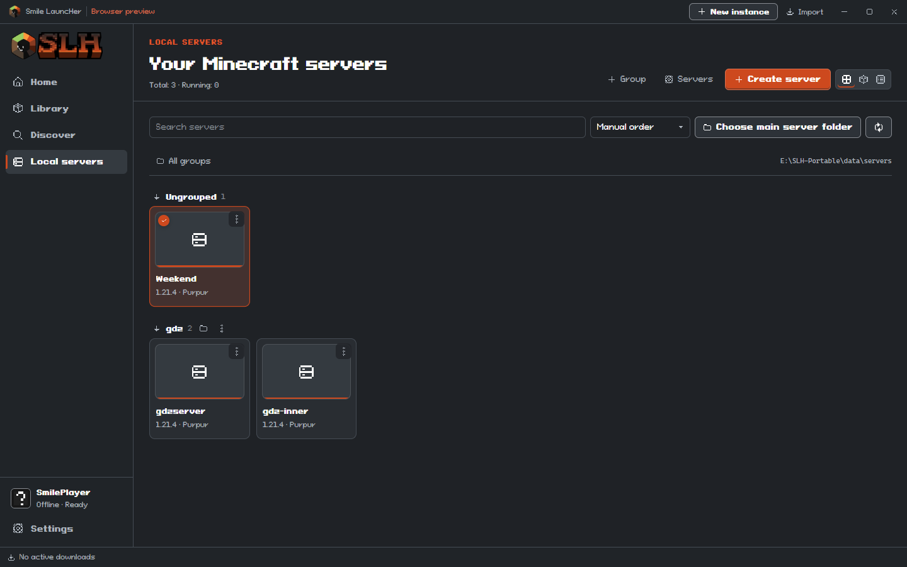
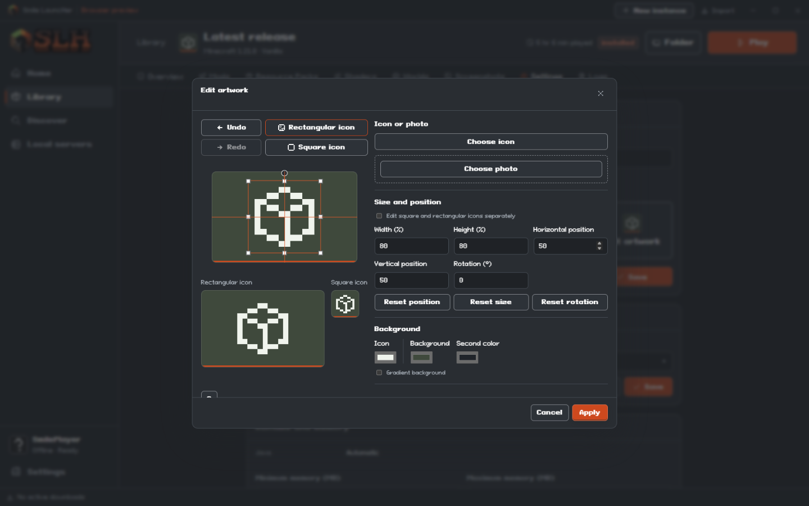
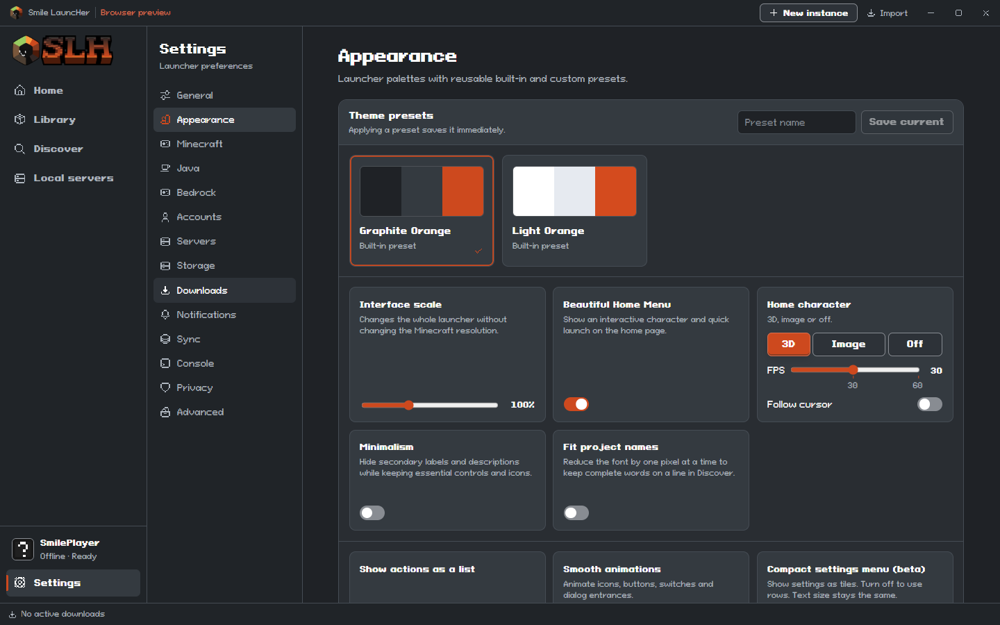
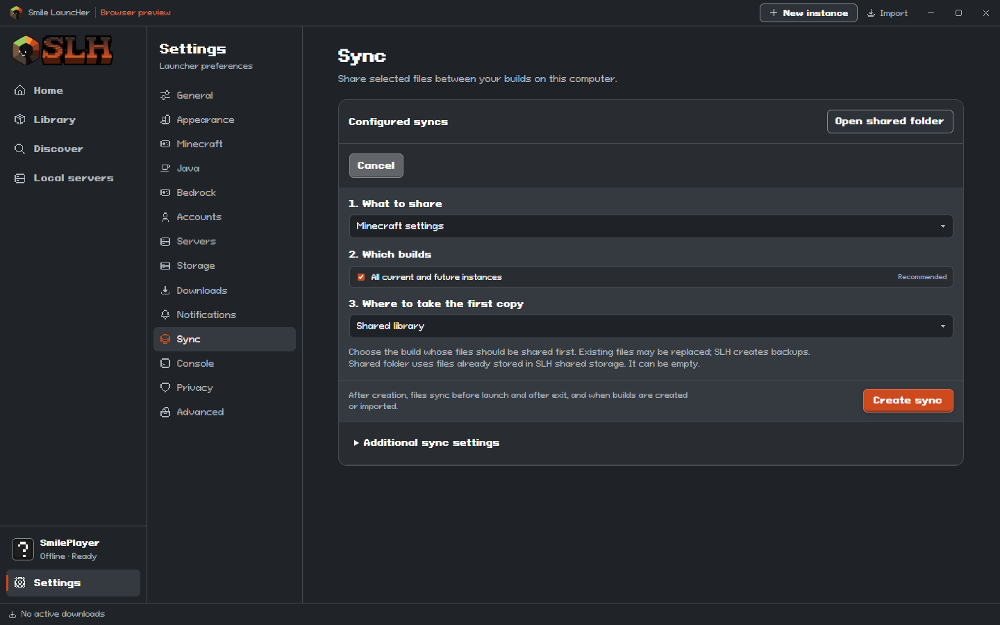

<p align="center"></p>

# Smile LauncHer

A Minecraft launcher for Windows, macOS and Linux with separate Java instances, content catalogs and local-server management.

[English](README.md) · [Русский](README.ru.md) · [Deutsch](README.de.md)

## Features

- Java instances with Vanilla, Fabric, Forge, NeoForge and Quilt, groups, grid/list views and individual settings.
- Microsoft, Ely.by and offline accounts; managed Java and detection of installed runtimes.
- Modrinth and CurseForge catalogs for modpacks, mods, resource packs and shaders, with version and loader filters.
- Local servers with console, configuration, player access lists and Java-core installation.
- Instance and server artwork with custom images, rotation, snapping and undo/redo.
- Java crash diagnostics with log evidence and shortcuts to relevant settings.
- Local synchronization of selected files between instances.
- Themes, panel placement, configurable animations and an optional 3D character on Home.
- English, Russian and German, plus custom translation files.

Bedrock support is Windows-only and uses official shared game data. Installed Store release and Preview packages can be attached; Preview installation is handled by Store/Xbox. Official Bedrock isolation is currently unavailable. See [Bedrock support](docs/bedrock-support.md).

The optional Horizon Rust client/server integration is experimental and requires compatible releases and hardware.

## Screenshots

Captured in Chrome using the browser preview and demonstration data. Account names, instances and catalog results are examples.



<details>
<summary>Instance library</summary>



</details>

<details>
<summary>Content catalogs</summary>



</details>

<details>
<summary>Local servers</summary>



</details>

<details>
<summary>Artwork editor</summary>



</details>

<details>
<summary>Appearance settings</summary>



</details>

<details>
<summary>Synchronization setup</summary>



</details>

## Download

Choose a package for your operating system on [GitHub Releases](https://github.com/slhmc/slh/releases). Test builds are marked as pre-releases.

| Platform | Installer / package | Portable / app archive |
| --- | --- | --- |
| Windows x64 | EXE, MSI | Portable ZIP |
| macOS Intel | DMG | App ZIP |
| macOS Apple Silicon | DMG | App ZIP |
| Linux x64 | DEB, RPM | AppImage |

Extract the entire Windows portable ZIP to a writable folder and run SLH.exe. It keeps launcher data beside the executable. Fresh installer builds use per-user storage; existing legacy data is preserved. macOS/Linux use platform user-data directories by default.

Windows requires Microsoft Edge WebView2 Evergreen. If it is missing, follow the launcher link to Microsoft’s runtime installer and restart SLH. macOS uses system WebKit; Linux requires WebKitGTK. Minecraft, Java and content are downloaded as needed.

Windows/Linux packages are unsigned. macOS packages are ad-hoc signed and not notarized.

## Data and accounts

Profiles and settings are stored locally. Login, downloads and update checks contact the relevant services. Microsoft login and CurseForge in custom builds depend on their configuration. See [authentication](AUTH.md) and [CurseForge access](CURSEFORGE_RELAY.md).

The data folder can contain credentials, worlds and private server information. Keep it private and back up important worlds before changing game versions or testing pre-releases.

## Build and contribute

See [BUILDING.md](BUILDING.md) for platform requirements and packaging, and [DEVELOPMENT.md](DEVELOPMENT.md) for development. Windows also requires the Bedrock helper build described there.

The interface uses React and TypeScript. Tauri/Rust handles launching, files and SQLite storage.

```sh
git clone --recurse-submodules https://github.com/slhmc/slh.git
cd slh
npm ci
npm run tauri:dev
```

## Documentation and support

- [Architecture](ARCHITECTURE.md)
- [Languages](LANGUAGES.md)
- [Portable storage](PORTABLE.md)
- [Report a bug or suggest a feature](https://github.com/slhmc/slh/issues)

## License

GNU General Public License v3.0. See [LICENSE](LICENSE).
