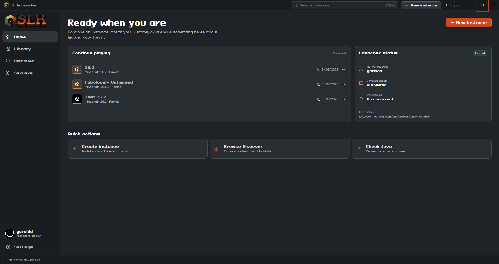
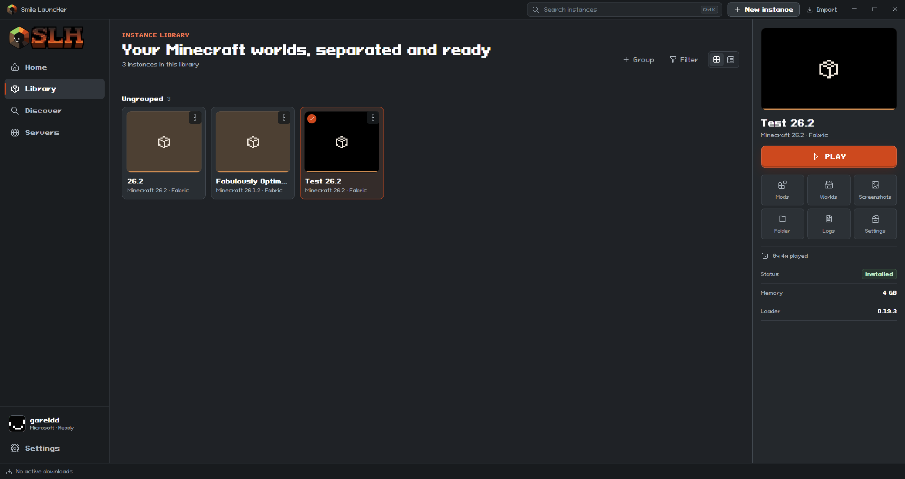
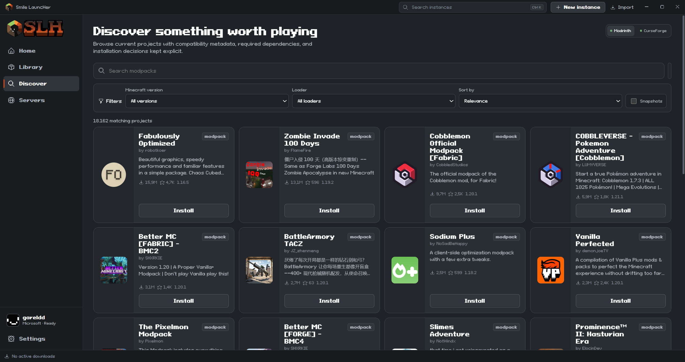
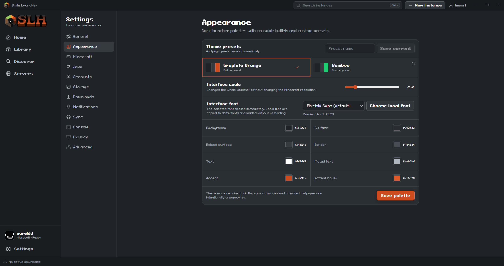
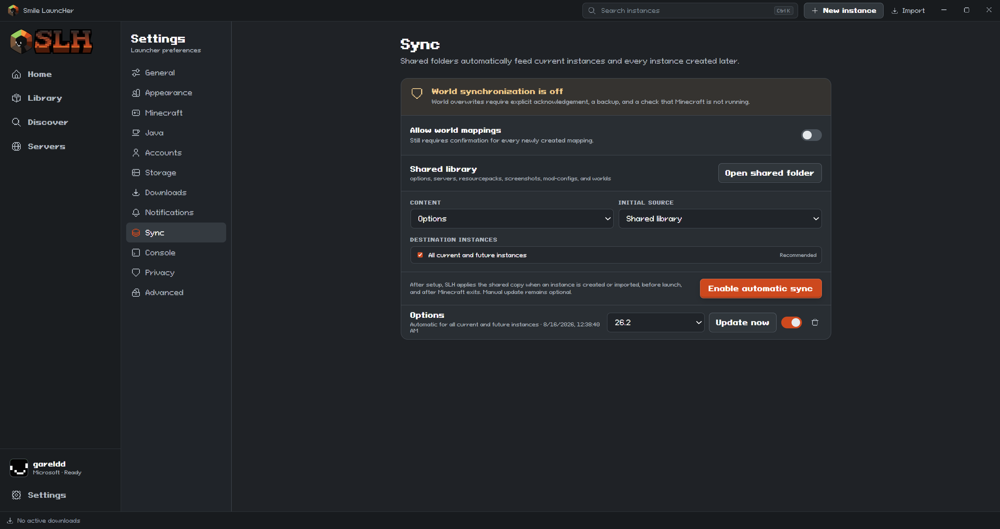
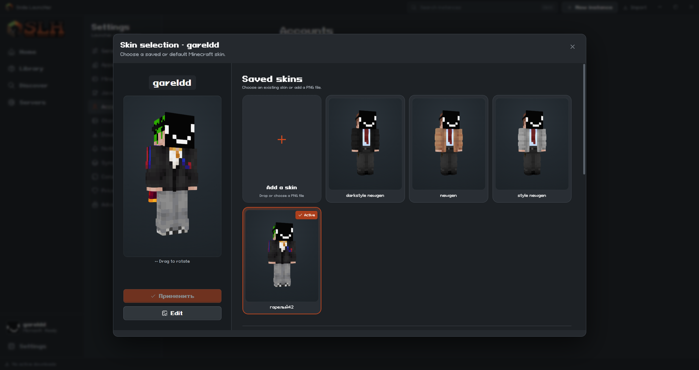
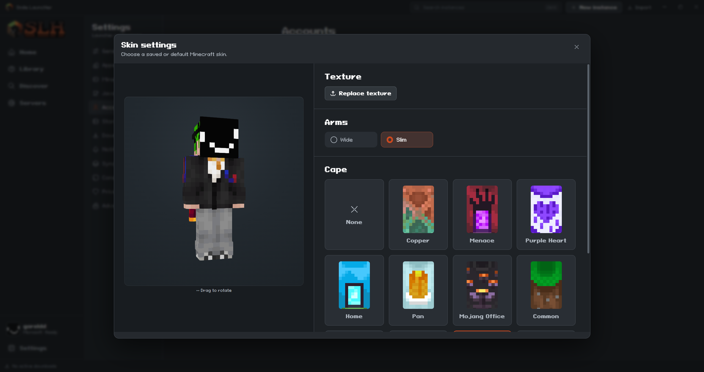

<p align="center">
  
</p>

# Smile LauncHer

A Minecraft launcher for Windows, macOS and Linux.

**Current pre-release:** [SLH 0.2.3](https://github.com/slhmc/slh/releases/tag/v0.2.3).

**Languages:** [English](README.md) · [Русский](README.ru.md) · [Deutsch](README.de.md)

SLH keeps Minecraft installations isolated, lets you manage accounts and Java locally, and downloads compatible content into the selected instance. It is built with Tauri, React, TypeScript, Rust and SQLite.

> **Status:** development release. Back up important worlds before trying a new build.

## Highlights

- Separate Minecraft instances with groups, grid/list views, logs, worlds, screenshots and per-instance settings.
- Vanilla, Fabric, Forge, NeoForge and Quilt; experimental Horizon on Windows x64.
- A persistent local-server library with console, player lists and live settings.
- Microsoft, Ely.by and offline accounts.
- Modrinth browsing and verified installation; CurseForge support when configured.
- Managed Eclipse Temurin Java 8, 17, 21 and 25, plus detection of installed Java runtimes.
- English, Russian and German included by default; custom locale files are supported.
- Optional local sharing of selected files between instances, with explicit configuration and backups.
- No analytics or advertising. Launcher data stays on the local machine.

## Screenshots

<p align="center"></p>

<p align="center"></p>

<p align="center"></p>

<p align="center"></p>

<p align="center"></p>

<table>
  <tr>
    <td width="50%"></td>
    <td width="50%"></td>
  </tr>
</table>

## Downloads

Get a build from [GitHub Releases](https://github.com/gareldd/slh/releases) and choose the matching Windows architecture.

| Package | Use it when |
| --- | --- |
| `*-setup.exe` | You want the simplest guided installation. |
| `*.msi` | You need an MSI package for managed or manual deployment. |
| `portable/` | You want a self-contained folder. Extract the **entire** folder to a writable local drive, then run `SLH.exe`. |

Portable releases use the system Microsoft Edge WebView2 Evergreen Runtime and do not bundle a private browser runtime. If it is missing, SLH offers to open Microsoft's official download page before creating its window; install the runtime and restart SLH. Windows installers download the bootstrapper when needed. A runtime download requires internet access. Existing local `webview2` folders are no longer selected; the portable build script removes them only after checking Evergreen and ensuring the output copy is not running.

Release packages are intentionally empty: they do not contain accounts, instances, Java installations, worlds, logs or caches.

## Privacy and accounts

SLH stores launcher data locally. Microsoft login requires a configured Microsoft client ID; CurseForge availability depends on its configured access route or key. Never commit, upload or share `data/`: it can contain accounts, tokens, worlds and private server information.

## Build from source

Requirements for Windows development:

- Node.js and npm
- Rust with the MSVC toolchain
- Visual Studio Build Tools with **Desktop development with C++**
- Microsoft Edge WebView2 Runtime

```powershell
npm install
npm run tauri:dev
```

Checks:

```powershell
npm run build
npm test
cargo test --manifest-path src-tauri/Cargo.toml
```

Build instructions, including portable packages and installers, are in [DEVELOPMENT.md](DEVELOPMENT.md) and [PORTABLE.md](PORTABLE.md).

> **Do not publish a personal `release/SLH-Portable` folder.** The portable build script deliberately preserves its `data/` directory so your development launcher keeps working. Create a clean release folder and verify that `data/` has no files before uploading it.

## Architecture

The UI is a React application displayed by WebView2. Rust/Tauri performs privileged work—files, SQLite, Java, Minecraft launching and network requests—through a typed IPC boundary. A development server may use `localhost`; published builds load their bundled interface locally and do not expose a public web server.

## Documentation and support

- [Architecture](ARCHITECTURE.md)
- [Authentication](AUTH.md)
- [Languages](LANGUAGES.md)
- [Portable storage](PORTABLE.md)
- [Report a bug or suggest an improvement](https://github.com/gareldd/slh/issues)

## License

SLH is released under the GNU General Public License v3.0 (GPLv3). See [LICENSE](LICENSE).
