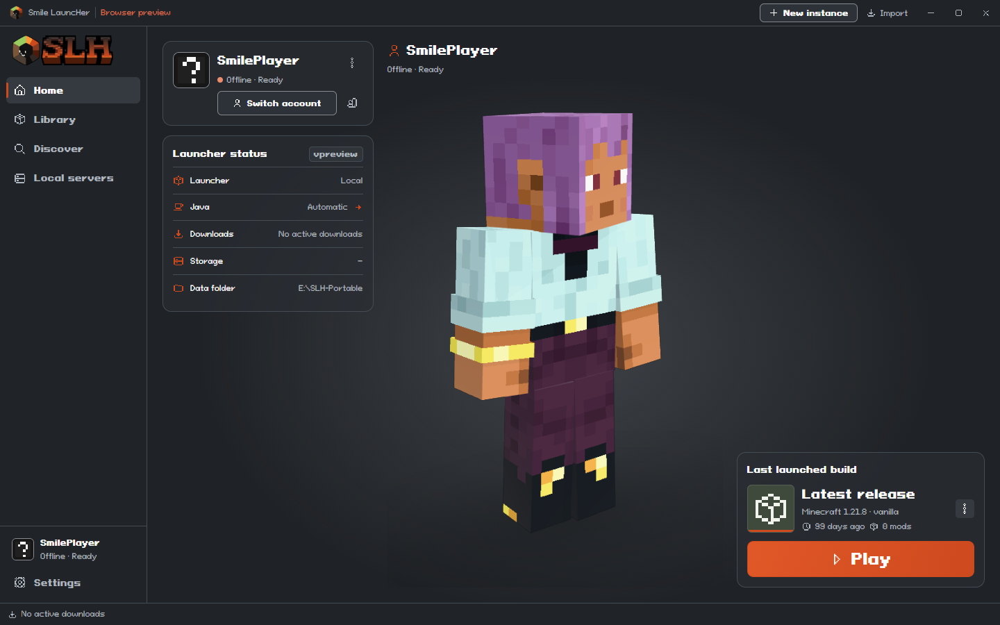
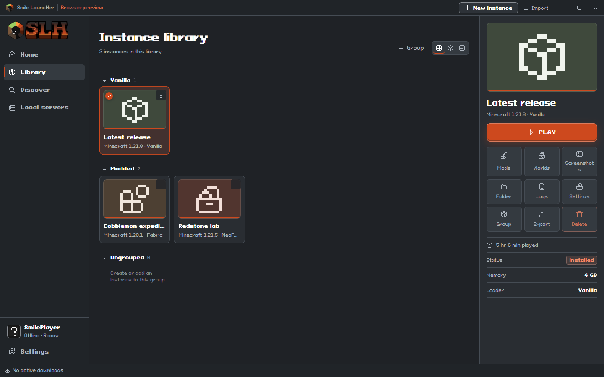
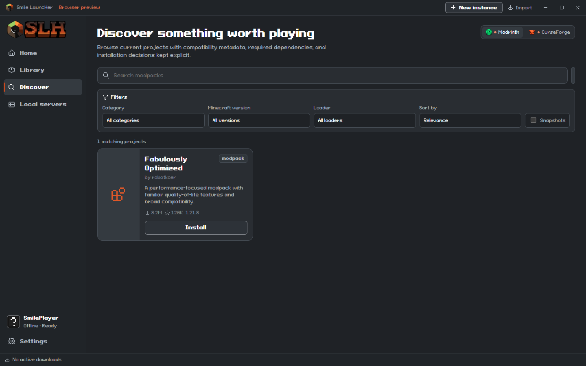
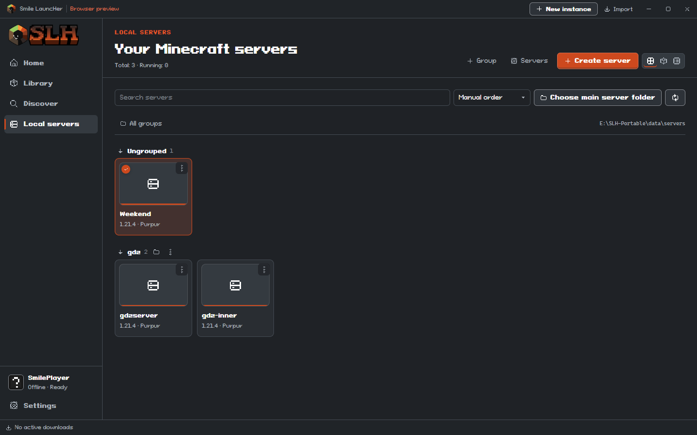
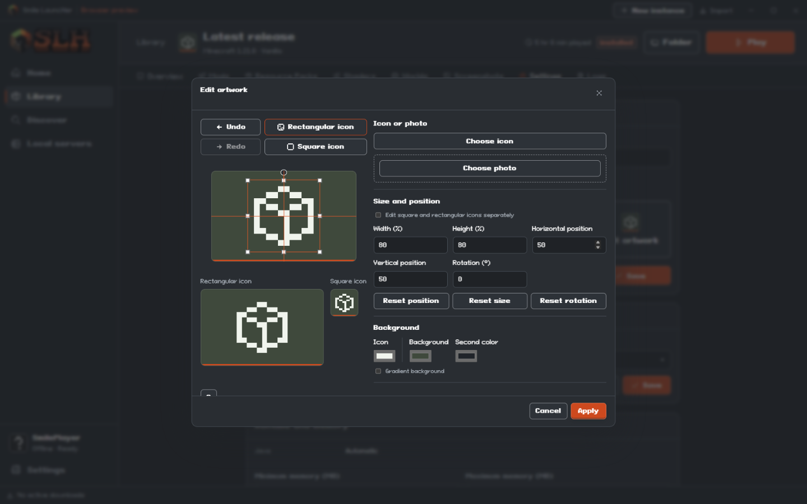
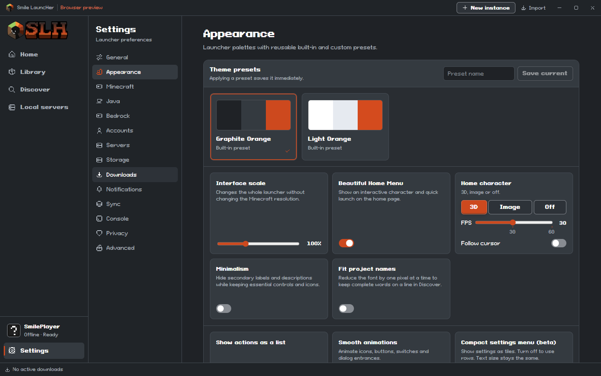
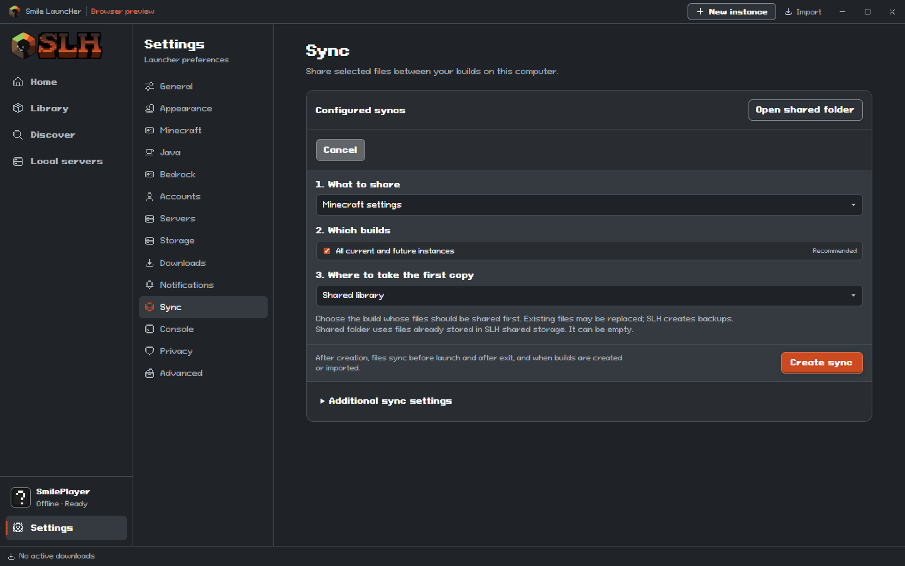

<p align="center"></p>

# Smile LauncHer

Лаунчер Minecraft для Windows, macOS и Linux с отдельными Java-сборками, каталогами контента и управлением локальными серверами.

[English](README.md) · [Русский](README.ru.md) · [Deutsch](README.de.md)

## Возможности

- Java-сборки с Vanilla, Fabric, Forge, NeoForge и Quilt, группами, сеткой или списком и отдельными настройками.
- Аккаунты Microsoft, Ely.by и офлайн-аккаунты, загрузка Java и поиск установленных сред.
- Каталоги Modrinth и CurseForge со сборками, модами, ресурспаками и шейдерами, фильтрами версии и загрузчика.
- Локальные серверы с консолью, конфигурацией, списками доступа и установкой Java-ядер.
- Оформление сборок и серверов, свои изображения, поворот, привязки, отмена и возврат.
- Диагностика вылетов Java со строками журнала и переходом к нужным настройкам.
- Локальная синхронизация выбранных файлов между сборками.
- Темы, расположение панелей, настраиваемые анимации и 3D-персонаж на главной.
- Русский, английский и немецкий языки, поддержка пользовательских переводов.

Bedrock доступен только на Windows и использует общие данные официальной игры. Можно подключить установленные Store-версию и Preview; установкой Preview управляет Store/Xbox. Изоляция официального Bedrock пока недоступна. См. [поддержку Bedrock](docs/bedrock-support.md).

Интеграция клиента и сервера Horizon на Rust экспериментальная, для неё нужны совместимые выпуски и оборудование.

## Скриншоты

Снимки сделаны в Chrome в браузерном предпросмотре с демонстрационными данными. Имена аккаунтов, сборки и результаты каталога приведены для примера.



<details>
<summary>Библиотека сборок</summary>



</details>

<details>
<summary>Каталоги контента</summary>



</details>

<details>
<summary>Локальные серверы</summary>



</details>

<details>
<summary>Редактор оформления</summary>



</details>

<details>
<summary>Внешний вид</summary>



</details>

<details>
<summary>Создание синхронизации</summary>



</details>

## Скачать

Выберите пакет для своей системы в [GitHub Releases](https://github.com/slhmc/slh/releases). Тестовые выпуски помечены как pre-release.

| Платформа | Установщик / пакет | Переносная версия / архив приложения |
| --- | --- | --- |
| Windows x64 | EXE, MSI | Portable ZIP |
| macOS Intel | DMG | App ZIP |
| macOS Apple Silicon | DMG | App ZIP |
| Linux x64 | DEB, RPM | AppImage |

Распакуйте весь Windows portable ZIP в доступную для записи папку и запустите SLH.exe. Данные хранятся рядом с приложением. Новая установка через установщик использует папку пользователя; существующие данные прежних установок сохраняются. На macOS и Linux по умолчанию используются системные папки данных пользователя.

На Windows нужна Microsoft Edge WebView2 Evergreen. Если среды нет, перейдите по ссылке лаунчера к установщику Microsoft и перезапустите SLH. На macOS используется системный WebKit, на Linux нужен WebKitGTK. Minecraft, Java и контент скачиваются по мере необходимости.

Пакеты Windows/Linux не подписаны. Пакеты macOS имеют локальную подпись без нотариализации.

## Данные и аккаунты

Профили и настройки хранятся локально. Вход в аккаунты, загрузки и проверка обновлений обращаются к соответствующим сервисам. Работа входа Microsoft и CurseForge в собственной сборке зависит от её конфигурации. Подробности — в документации [аутентификации](AUTH.md) и [доступа к CurseForge](CURSEFORGE_RELAY.md).

Папка данных может содержать учётные данные, миры и сведения о приватных серверах. Храните её приватно и делайте копии важных миров перед сменой версии игры или проверкой тестового выпуска.

## Сборка и участие в разработке

Требования платформ и упаковка описаны в [BUILDING.md](BUILDING.md), работа с проектом — в [DEVELOPMENT.md](DEVELOPMENT.md). Для Windows также нужна сборка помощника Bedrock по этой инструкции.

Интерфейс написан на React и TypeScript. Tauri/Rust отвечает за запуск, файлы и хранилище SQLite.

```sh
git clone --recurse-submodules https://github.com/slhmc/slh.git
cd slh
npm ci
npm run tauri:dev
```

## Документация и поддержка

- [Архитектура](ARCHITECTURE.md)
- [Языки](LANGUAGES.md)
- [Переносное хранилище](PORTABLE.md)
- [Сообщить об ошибке или предложить функцию](https://github.com/slhmc/slh/issues)

## Лицензия

GNU General Public License v3.0. См. [LICENSE](LICENSE).
